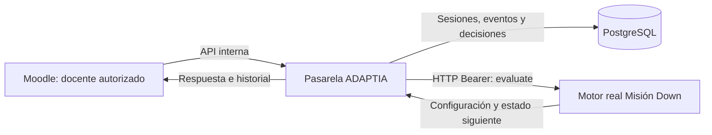

# Integración local de Misión Down con ADAPTIA

El piloto docente de Moodle registra ensayos ficticios, consulta el motor real de
Misión Down y conserva sus decisiones en PostgreSQL. El núcleo se ejecuta como
servicio Python local; este recorrido no necesita Firebase ni una API de IA externa.

## Arquitectura y contrato



| Componente | Dirección local | Identidad y datos |
| --- | --- | --- |
| Moodle | `http://localhost:8086` | Usuario Moodle y permiso docente del curso. |
| Pasarela | `http://localhost:5000` | Credencial interna; docente y curso seudonimizados. |
| Motor Down | `http://localhost:5200/extensions/v1/down` | Credencial de servicio; no persiste sesiones. |
| PostgreSQL | Red privada Docker | Sesiones, ensayos, estado y decisiones del piloto. |

El contrato de la extensión es 1.1.0. Los catálogos utilizados informan modelo
0.3.0, reglas 1.1.0 y parámetros 1.1.0. Son versiones distintas. El código del motor
corresponde al commit `1bbca2e` de la rama `qa/biometria-feedback-2026-11-23` del
repositorio Misión Down. Su documentación pública está en `backend/README.md` y
`docs/fase2/integracion_adaptia.md` de ese repositorio.

La pasarela llama a `/health`, `/rules`, `/games` y `/evaluate`. Envía
`preferences`, `params_version` y `interaction_event.paused_ms`; el servidor admite
esos campos como opcionales y conserva las peticiones del contrato anterior.
El consumidor fija las preferencias y versiones al abrir la sesión y conserva el
`model_state` del motor. El navegador no recibe la credencial de servicio.

## Configuración reproducible

`compose.yaml` monta por defecto el checkout hermano
`../../andres-morocho/mision_down-dashboard` en solo lectura. Para otra ubicación,
definir `MISION_DOWN_SOURCE` en `.env`, con una ruta absoluta o relativa a
`ambiente-local`. Deben existir `backend/src` y `docs/fase2` dentro del checkout.

`ADAPTIA_DOWN_URL` vacío usa `http://down:5200/extensions/v1/down`.
`ADAPTIA_DOWN_TOKEN` es opcional en local; si está vacío, se utiliza la credencial
interna ya configurada. Las claves pertenecen a `.env`, ignorado por Git; no se
incluyen valores reales en la documentación ni en capturas.

Con las imágenes ya instaladas, desde `ambiente-local`:

```bash
docker compose -f compose.yaml -f compose.tutoria.yaml up -d --no-build --pull never --wait down
docker compose -f compose.yaml -f compose.tutoria.yaml ps
```

`compose.tutoria.yaml` conserva la red compartida de la instalación integrada.
En una instalación independiente que no use esa red, se ejecuta solo `compose.yaml`.
El cambio de montaje actualiza el motor local; no despliega funciones en Firebase.

## API interna del piloto

| Operación | Ruta |
| --- | --- |
| Catálogos y versiones | `GET /api/v1/down/catalogs` |
| Crear o listar sesiones | `POST` o `GET /api/v1/down/sessions?course_ref=...` |
| Consultar estado e historial | `GET /api/v1/down/sessions/{id}?course_ref=...` |
| Registrar ensayo | `POST /api/v1/down/sessions/{id}/trials?course_ref=...` |
| Reintentar operación pendiente | `POST /api/v1/down/sessions/{id}/retry?course_ref=...` |

Se exige credencial interna y `X-ADAPTIA-Actor`. Las sesiones se aíslan por docente
y curso. La creación usa `Idempotency-Key`; cada ensayo tiene UUID y secuencia.
Un reenvío idéntico conserva la respuesta, pero un evento modificado se rechaza.
Un fallo del proveedor conserva el estado y el ensayo pendiente para reintentar.
No se interpreta el fallo técnico como una respuesta incorrecta del estudiante.

## Identidad y roles

| Sistema | Dato o permiso | Alcance |
| --- | --- | --- |
| Flutter | Firebase Authentication y `users.role` en Firestore | Perfil `Padre` o `Profesional`; no concede administración. |
| Dashboard Misión Down | Claim firmado Firebase `rol: admin` o `profesional` | La API `/admin/v1` valida el token y el claim. |
| Moodle | Roles del curso y `local/adaptia_core:managerequests` | Autoriza el piloto docente; estudiantes no acceden. |
| Pasarela y motor | Credenciales entre servicios | Transporte privado, sin usar el rol autoelegido en Flutter. |

Flutter y el dashboard identifican el mismo proyecto Firebase `misiondown-44234`.
La rama del proveedor `feat/roles-dashboard` añade alta y retirada auditadas de
acceso profesional desde el dashboard; protege administradores y comprueba el
permiso vigente en cada nueva petición. La asignación de administradores sigue en
el script privilegiado `asignar_rol.py`. Contrato, incidencias y límites en la
[guía del proveedor](https://github.com/KAndresMR/mision_down/blob/feat/roles-dashboard/backend/README.md#gestión-auditada-de-acceso-profesional).
La publicación de la rama no despliega esa funcionalidad. El perfil de Flutter
sigue siendo único: no se ha añadido un selector de perfiles al iniciar sesión.
La identidad Moodle no se vincula automáticamente con Firebase; tampoco se ha
implementado una autorización profesional-niño compartida entre los sistemas.

## Resultado comprobado el 23/11/2026

La ejecución final aprobó tres sesiones completas (60 ensayos). Una consulta
posterior confirmó en PostgreSQL 21 registros por sesión, `completed`,
`last_seq=20` y ausencia de operaciones pendientes. Pasaron escritorio/móvil,
aislación entre docentes, bloqueo de estudiantes y CSRF. La pasarela aprobó 39
casos en `adaptia_test`; el proveedor tiene su validación independiente de 401
casos y 2 subtests, que no se suman como porcentaje de cobertura.

[Informe visual con capturas incrustadas](validacion-integracion-adaptia-mision-down-2026-11-23.pdf).
El curso compartido conserva el rótulo histórico `[MOCK]`; la ruta Down comprobada
utiliza el motor Python real y sus catálogos, montados desde QA.

## Recorrido de comprobación

Desde un curso, abrir **Misión Down · Integración**. Iniciar una sesión con un
juego y registrar tres errores: el apoyo debe pasar de 1 a 2 manteniendo los
distractores. Continuar hasta 20 ensayos; la pantalla debe indicar finalización,
ocultar el formulario y conservar el inicio más los veinte ensayos en el historial.

Automatización con Playwright ya instalado:

```bash
PLAYWRIGHT_PATH=/ruta/al/paquete/playwright node tests/down.cjs
```

`ADAPTIA_DOWN_QA_ARTIFACTS` permite elegir una carpeta privada para resultados y
capturas. La prueba ejecuta tres sesiones de veinte ensayos, consulta el historial,
comprueba escritorio/móvil, aislamiento entre docentes, bloqueo de estudiantes y
CSRF. Usa cuentas ficticias temporales, que elimina al terminar. Las capturas no
se versionan sueltas; las evidencias para compartir se incorporan en el informe.

Para pruebas de pasarela, `python3 bootstrap.py --test` usa exclusivamente la base
y el rol `adaptia_test`; la primera preparación puede construir imágenes. La
comprobación actual reutilizó las imágenes instaladas y aprobó 39 casos, incluidos
el motor Down real, persistencia, duplicados y aislamiento. No se suman estos casos
con los de otros repositorios como porcentaje de cobertura.

## Alcance pendiente

Este piloto no ejecuta los tableros Flutter, ni valida aprendizaje con niños.
La app sigue necesitando la comprobación de su conexión con `/v1`, su cola durable
y el historial remoto. La extensión antigua de Firebase y este servicio local
son despliegues distintos; el cambio local no actualiza la nube. Tampoco acredita
el motor general de ADAPTIA, TutorIA con IA externa ni una administración unificada
de roles. Los costos de alojamiento institucional se verifican aparte: una prueba
local sin proveedor externo no garantiza costo cero para cualquier despliegue.
